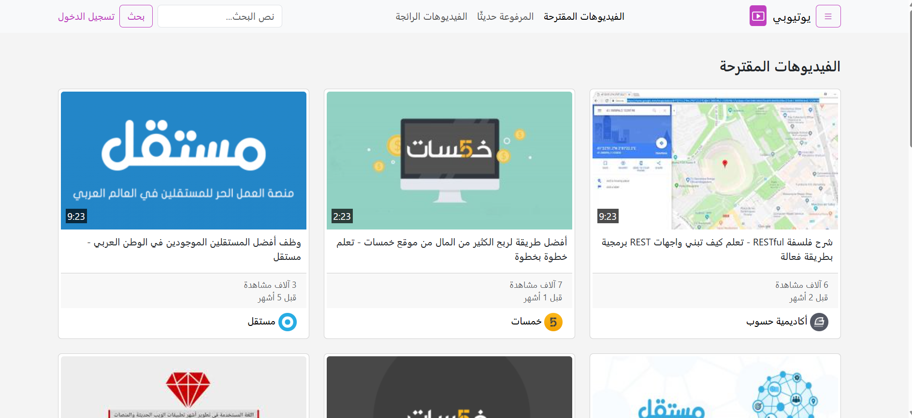

# YouTubeiby (يوتيوبي) — Video Sharing Platform Frontend

<a name="english"></a>

A responsive, multi-page Arabic (RTL) video-sharing platform interface inspired by YouTube, built with **Bootstrap 5 (RTL)**, **Vanilla JavaScript**, and **Vite**.

---

### 📌 About the Project
**YouTubeiby (يوتيوبي)** is a complete multi-page front-end web application developed as part of the User Interface Development track at Hsoub Academy. 
The project simulates a modern video streaming platform with **8 interconnected pages**, combining **Bootstrap 5.3 RTL** components (Offcanvas sidebar, Tabbed lists, Horizontal & Vertical Cards, Dropdowns, and Ratios) with modular **JavaScript** to handle interactive UI behaviors such as search filters, expandable video descriptions, nested comment replies, and watch history management.

### 🚀 Live Demo
[View Live Demo](https://mohammed-MFSA99.github.io/youtube-frontend/) 

### 📸 Screenshots
* **Home Page (Desktop View)**
  

---

### ✨ Features & Pages
- **Responsive Navigation & Offcanvas Sidebar:** Fixed top navbar with a search bar returning results on `search-results.html`, a login button, and a collapsible **Offcanvas** navigation drawer accessible across all pages.
- **Home Page (`index.html`):**
  - **Suggested Videos:** Responsive 3-column card grid with video duration badges and "Watch Later" hover icons.
  - **Recently Uploaded:** 16:9 aspect-ratio figures (`ratio-16x9`) with overlay badges and `stretched-link` navigation.
  - **Trending Videos:** Interactive Master-Detail layout using Bootstrap List Group Tabs (`data-bs-toggle="list"`) to preview trending videos.
- **Video Watch Page (`watch.html`):**
  - **HTML5 Video Player:** Supports `.webm` and `.mp4` formats with a custom poster and Arabic closed captions (`caption.vtt`).
  - **Expandable Description:** Interactive "Show More / Show Less" (`عرض المزيد`) toggle powered by JavaScript.
  - **Interactive Comments Section:** Includes comment sorting dropdown, public comment form, star ratings, and toggleable nested reply cards (`.reply` & `.card-inner`).
  - **Suggested Sidebar:** Vertical list of recommended videos alongside the main player.
- **Channel Page (`channel.html`):** Features a channel cover banner, secondary navigation bar, featured channel video player with expandable description, and a grid of recently uploaded channel videos.
- **Search Results Page (`search-results.html`):** Displays horizontal video cards with an interactive **Filter Panel (`تصفية`)** that toggles 4 filter categories (Upload Date, Type, Sort By, Duration) with single-choice checkbox logic.
- **Watch History Page (`history-log.html`):** Includes a sidebar filter (by history type and timeframe) and interactive delete buttons (`.remove`) to remove individual videos from the watch history DOM.
- **Authentication Pages:** Clean, centered card layouts for **Login** (`login.html`), **Sign Up** (`signup.html`), and **Password Recovery** (`forget-my-password.html`).

---

### 🛠️ Technologies
- **HTML5** (Semantic elements, `<video>`, `<track>` VTT captions)
- **CSS3** (Custom styling & responsive overrides)
- **Bootstrap 5.3.8 (RTL)**
- **Bootstrap Icons 1.13.1**
- **JavaScript (ES6+ Modules)**
- **Vite** (Frontend Build Tool & Bundler)
- **GitHub Actions** (Automated deployment workflow to GitHub Pages)

---

### 📂 Project Structure
```text
youtube-frontend/
│
├── .github/
│   └── workflows/
│       └── deploy.yml          # GitHub Pages automated deployment
│
├── public/
│   └── video/
│       ├── hsoub.mp4
│       ├── hsoub.webm
│       └── caption.vtt         # Arabic video subtitles
│
├── img/
│   ├── icons/                  # Social & platform icons
│   ├── thumbnail/              # Video thumbnails
│   ├── avatar.jpg
│   ├── ch-logo.png
│   ├── h-channel.jpg
│   ├── khamsat.jpg
│   ├── mostaql.png
│   └── poster.png
│
├── src/
│   ├── css/
│   │   ├── style.css           # Global styles
│   │   ├── watch.css           # Watch & Channel page styles
│   │   └── history-log.css     # History & Search results styles
│   ├── js/
│   │   ├── watch.js            # Read more & comment replies logic
│   │   ├── search-results.js   # Filter toggle & checkbox logic
│   │   └── history-log.js      # Remove video from history logic
│   └── main.js                 # Main entry script
│
├── index.html                  # Home page
├── watch.html                  # Video player & comments page
├── channel.html                # Channel profile page
├── search-results.html         # Search results & filters page
├── history-log.html            # Watch history management page
├── login.html                  # User login page
├── signup.html                 # User registration page
├── forget-my-password.html     # Password reset page
└── README.md
```

---

### 📱 Responsive Design
The platform is fully responsive and tested across:
- **Extra Large & Desktop Screens** (`col-xl-*`, `col-lg-*`)
- **Tablets** (`col-md-*`, adaptive horizontal-to-vertical cards)
- **Mobile Devices** (`col-sm-*`, `col-12`, collapsible navbar & Offcanvas drawer)

---

### 📚 What I Learned
Through building this project, I practiced:
- Structuring a **multi-page RTL web application** using **Bootstrap 5.3** and **Vite**.
- Building complex responsive layouts using Bootstrap **Offcanvas**, **List Group Tabs**, **Ratio helpers (`ratio-16x9`)**, and **Flex/Grid utilities**.
- Writing modular **Vanilla JavaScript** for DOM manipulation (toggling filter panels, expanding/collapsing text, managing nested comment replies, and deleting history items).
- Configuring **GitHub Actions** (`deploy.yml`) for continuous deployment of a Vite multi-page project.

---

### 🔮 Future Improvements
- Add Dark Mode support using Bootstrap 5.3 color modes (`data-bs-theme="dark"`).
- Implement real client-side search filtering by video title.
- Persist watch history deletions using `localStorage`.

---

### 👨‍💻 Author
**Mohammed Faez**  
*Frontend Web Developer*
- **GitHub:** [@mohammed-MFSA99](https://github.com/mohammed-MFSA99)
- **LinkedIn**: [Mohammed Faez](https://www.linkedin.com/in/mohammed-faez-alameri)

### 📄 License
This project is available under the MIT License.

---

<!-- <a name="arabic"></a>

<div dir="rtl">

## 🇾🇪 العربية

واجهة أمامية متكاملة ومتجاوبة لمنصة مشاركة ومشاهدة الفيديوهات باللغة العربية (**يوتيوبي — YouTubeiby**) تحاكي منصة يوتيوب، تم بناؤها باستخدام **Bootstrap 5.3 (RTL)** و **JavaScript** وأداة البناء **Vite**.

### 📌 عن المشروع
مشروع **يوتيوبي (YouTubeiby)** هو تطبيق ويب متعدد الصفحات (8 صفحات مترابطة) للواجهات الأمامية، تم تطويره ضمن مسار تطوير واجهات المستخدم في أكاديمية حسوب.
يجمع المشروع بين مكونات **Bootstrap 5 (نسخة RTL)** المتقدمة (مثل القائمة الجانبية المنزلقة Offcanvas، نظام التبويبات التفاعلية، البطاقات الأفقية والعمودية، ونسب العرض `ratio-16x9`) وبين لغة **JavaScript** لإدارة التفاعلات الحية في الواجهة مثل فلترة نتائج البحث، توسيع وصف الفيديو، إظهار الردود على التعليقات، وحذف الفيديوهات من سجل المشاهدة.

### 🚀 المعاينة الحية (Live Demo)
[مشاهدة الموقع مباشرة](https://mohammed-MFSA99.github.io/youtube-frontend/) *(ملاحظة: تأكد من مطابقة اسم المستودع في الرابط لحسابك على GitHub)*

### ✨ المميزات وصفحات المشروع
- **شريط تنقل علوي وقائمة جانبية (Offcanvas):** شريط علوي ثابت يحتوي على نموذج بحث ينقل المستخدم إلى صفحة النتائج، مع قائمة جانبية منزلقة (`Offcanvas`) للوصول السريع لجميع أقسام المنصة.
- **الصفحة الرئيسية (`index.html`):**
  - **قسم الفيديوهات المقترحة:** شبكة بطاقات متجاوبة تعرض الصور المصغرة، مدة الفيديو، وأيقونة "المشاهدة لاحقاً".
  - **قسم المرفوعة حديثاً:** عرض الفيديوهات بأبعاد قياسية (`ratio-16x9`) مع طبقات متراكبة (`video-overlay`) وروابط ممتدة (`stretched-link`).
  - **قسم الفيديوهات الرائجة:** نظام تبويبات تفاعلي (`List Group Tabs`) يتيح التبديل بين الفيديوهات الرائجة ومعاينتها مباشرة.
- **صفحة المشاهدة (`watch.html`):**
  - **مشغل فيديو HTML5:** يدعم صيغ `.mp4` و `.webm` مع صورة غلاف (`poster`) وملف ترجمة عربية مدمج (`caption.vtt`).
  - **توسيع الوصف:** زر تفاعلي (**عرض المزيد / عرض أقل**) لإظهار أو طي النص الكامل لوصف الفيديو.
  - **قسم التعليقات والردود:** يتضمن إضافة تعليق، قائمة منسدلة للترتيب، تقييم بالنجوم، وأزرار تفاعلية لإظهار/إخفاء الردود الفرعية على كل تعليق.
  - **قائمة الاقتراحات الجانبية:** عمود مخصص لعرض الفيديوهات المقترحة بجانب المشغل.
- **صفحة القناة (`channel.html`):** تحتوي على صورة غلاف القناة (`Banner`)، قائمة تنقل فرعية لأقسام القناة، الفيديو التعريفي الرئيسي، وشبكة لآخر الفيديوهات المرفوعة.
- **صفحة نتائج البحث (`search-results.html`):** تعرض نتائج البحث في بطاقات أفقية متجاوبة، مع زر **تصفية (`#search-filter-icon`)** يفتح لوحة فلاتر مقسمة إلى 4 أعمدة (تاريخ التحميل، النوع، التصنيف بحسب، المدة) مع التحكم في تحديد الخيارات عبر JavaScript.
- **صفحة سجل المشاهدة (`history-log.html`):** تتيح تصفية السجل حسب النوع والتاريخ، مع إمكانية حذف أي فيديو من السجل مباشرة عبر النقر على أيقونة الحذف (`X`).
- **صفحات المصادقة (3 صفحات):** تصميم متناسق لصفحات **تسجيل الدخول** (`login.html`)، **إنشاء حساب جديد** (`signup.html`)، و**استعادة كلمة المرور** (`forget-my-password.html`).

### 🛠️ التقنيات المستخدمة
- **HTML5**
- **CSS3**
- **Bootstrap 5.3.8 (RTL)**
- **Bootstrap Icons 1.13.1**
- **JavaScript (ES6 Modules)**
- **Vite** (أداة البناء وحزم الملفات)
- **GitHub Actions** (للنشر التلقائي على GitHub Pages)

### 📂 هيكلة المشروع
<div dir="ltr">

```text
youtube-frontend/
│
├── .github/
│   └── workflows/
│       └── deploy.yml          # إعدادات الرفع التلقائي على GitHub Pages
│
├── public/
│   └── video/
│       ├── hsoub.mp4
│       ├── hsoub.webm
│       └── caption.vtt         # ملف الترجمة العربية للفيديو
│
├── img/
│   ├── icons/
│   ├── thumbnail/              # الصور المصغرة للفيديوهات
│   ├── avatar.jpg
│   ├── ch-logo.png
│   ├── h-channel.jpg
│   ├── khamsat.jpg
│   ├── mostaql.png
│   └── poster.png
│
├── src/
│   ├── css/
│   │   ├── style.css           # التنسيقات العامة للمنصة
│   │   ├── watch.css           # تنسيقات صفحة المشاهدة والقناة
│   │   └── history-log.css     # تنسيقات سجل المشاهدة ونتائج البحث
│   ├── js/
│   │   ├── watch.js            # منطق زر عرض المزيد والردود على التعليقات
│   │   ├── search-results.js   # منطق قائمة التصفية والفلاتر
│   │   └── history-log.js      # منطق حذف الفيديوهات من سجل المشاهدة
│   └── main.js                 # الملف الرئيسي
│
├── index.html                  # الصفحة الرئيسية
├── watch.html                  # صفحة المشاهدة والتعليقات
├── channel.html                # صفحة القناة
├── search-results.html         # صفحة نتائج البحث والتصفية
├── history-log.html            # صفحة سجل المشاهدة
├── login.html                  # صفحة تسجيل الدخول
├── signup.html                 # صفحة إنشاء حساب جديد
├── forget-my-password.html     # صفحة استعادة كلمة المرور
└── README.md
```

</div>

### 📱 التجاوب مع الشاشات
تم تصميم جميع الصفحات الـ 8 لتعمل بتناسق تام على:
- شاشات سطح المكتب واللابتوب (Desktop & Large Screens)
- الأجهزة اللوحية (Tablets)
- الهواتف المحمولة (Mobile Devices)

### 📚 ماذا تعلمت من هذا المشروع؟
خلال بناء هذا المشروع، طبّقت المهارات التالية:
- هيكلة وتطوير مشروع واجهات أمامية **متعدد الصفحات (Multi-Page Application)** يدعم العربية (RTL) باستخدام **Bootstrap 5** و **Vite**.
- توظيف مكونات Bootstrap المتقدمة مثل **Offcanvas**، **List Group Tabs**، **Cards**، و **Ratios**.
- كتابة كود **JavaScript** منظم للتعامل مع أحداث DOM (إظهار/إخفاء الفلاتر والردود، التحكم في مربعات الاختيار، وحذف العناصر ديناميكياً).
- إعداد سير عمل **GitHub Actions** لبناء المشروع ونشره تلقائياً على GitHub Pages.

### 🔮 تحسينات مستقبلية
- إضافة الوضع الليلي (Dark Mode) باستخدام خاصية `data-bs-theme="dark"` في Bootstrap 5.3.
- تفعيل البحث الفعلي في عناوين الفيديوهات باستخدام JavaScript.
- حفظ التغييرات في سجل المشاهدة باستخدام `localStorage`.

### 👨‍💻 المطور
**محمد فائز سعيد**  
*مطور واجهات أمامية (Frontend Web Developer)*
- **GitHub:** [@mohammed-MFSA99](https://github.com/mohammed-MFSA99)

### 📄 الرخصة
هذا المشروع متاح تحت رخصة MIT.

</div> -->
